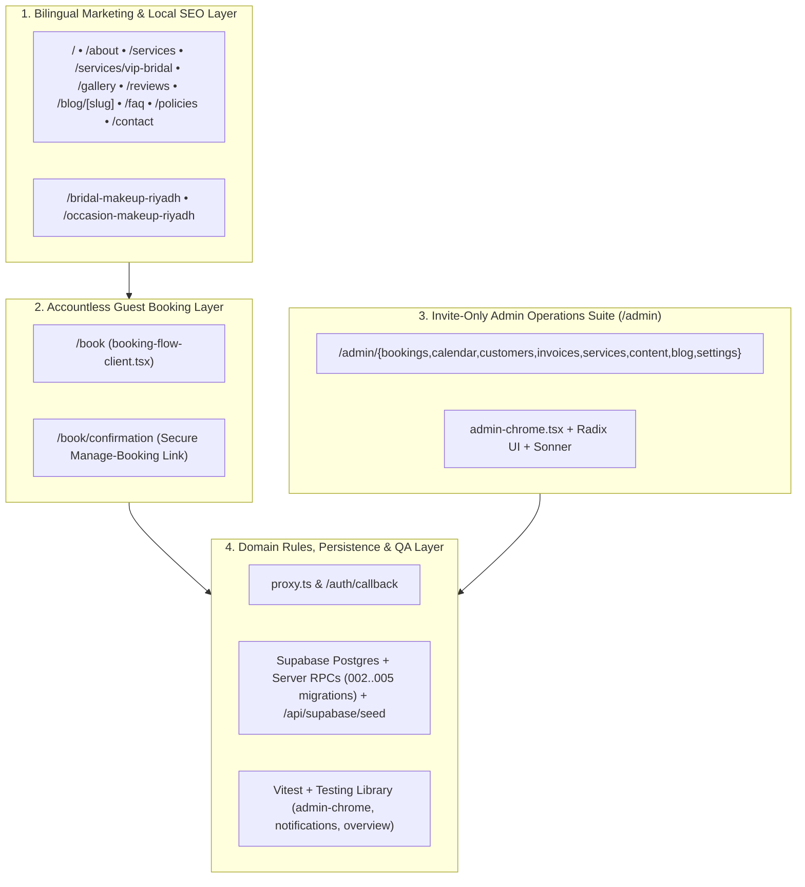
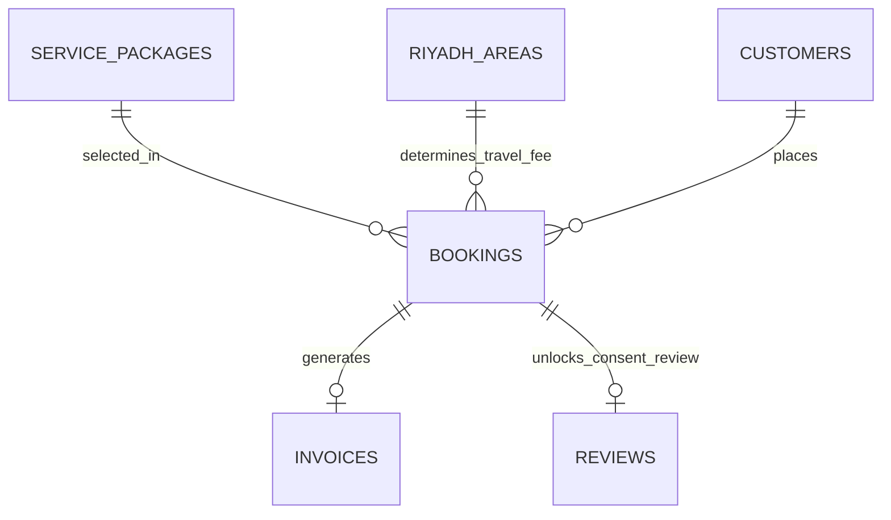

# Amani Khalil (`Amani-KhalIi`) — Luxury Bridal & Occasion Makeup Booking Platform (Riyadh)

<p align="center">
  
</p>

## Table of Contents
- [Executive Summary & Business Utility](#executive-summary--business-utility)
- [Visual Showcase (UI & Dashboards)](#visual-showcase-ui--dashboards)
- [System Architecture & Layers](#system-architecture--layers)
- [Data Model & Business Rules](#data-model--business-rules)
- [Database Schema, Migrations & RLS](#database-schema-migrations--rls)
- [Application Modules & API Endpoints](#application-modules--api-endpoints)
- [Getting Started & Scripts](#getting-started--scripts)
- [Business Value, ROI & Growth Opportunities](#business-value-roi--growth-opportunities)

---

## Executive Summary & Business Utility
`Amani-KhalIi` is a bilingual (Arabic-first, English second) Next.js 16 and Supabase luxury beauty booking and business management platform for **Amani Khalil**, a certified makeup artist providing private in-home sessions across **Riyadh, Saudi Arabia**. Designed to convert mobile visitors into deposit-secured bookings in **under two minutes without requiring account registration**, it combines SEO-targeted local landing pages, an artist-capacity-aware booking engine (`Asia/Riyadh`, `SAR`), and a full-featured `/admin` operations suite.

---

## Visual Showcase (UI & Dashboards)
Real brand & portfolio photography from `public/` and `public/gallery/`:

| Hero Brand Visual | Studio Portrait | Bridal Client Showcase |
| :---: | :---: | :---: |
|  |  |  |

| Gallery Look 1 | Gallery Look 2 | Gallery Look 3 |
| :---: | :---: | :---: |
|  |  |  |

---

## System Architecture & Layers



| Layer | Responsibility | Key Files |
| :--- | :--- | :--- |
| **Marketing & Local SEO Layer** | Arabic-first trust building, animated studio banner, scroll reveals, and Riyadh SEO funnels | `app/(marketing)/*`, `app/{bridal-makeup-riyadh,occasion-makeup-riyadh,services/vip-bridal}/page.tsx` |
| **Guest Booking Layer** | Frictionless <2 min mobile booking flow with phone verification, Riyadh district travel fees, and confirmation | `app/book/_components/booking-flow-client.tsx`, `app/book/confirmation/_components/confirmation-client.tsx` |
| **Admin Operations Layer** | Role-gated calendar, booking triage, customer CRM, invoicing, dynamic service pricing, and CMS | `app/admin/{bookings,calendar,customers,invoices,services,content,blog,settings}/page.tsx` |
| **Security & RPC Layer** | Server-side pricing calculation, atomic booking confirmation RPCs, and invite-only admin auth | `proxy.ts`, `supabase/migrations/002..005*.sql` |
| **QA & Component Layer** | Radix UI primitives and Vitest component/admin tests | `components/ui/*`, `components/__tests__/*`, `app/admin/_components/__tests__/admin-overview.test.tsx` |

---

## Data Model & Business Rules
- **Timezone & Currency**: Strict `Asia/Riyadh` (UTC+3) display with UTC database persistence and `SAR` pricing.
- **Zero Hardcoded Prices**: All packages, add-ons, district travel fees, and deposit percentages live in `service_packages`, `addons`, and `riyadh_areas`.
- **Artist-Aware Capacity**: Designed around ~2-hour sessions and ~2 sessions/day per artist (`CLIENT_HOME` now, `STUDIO` ready).



---

## Database Schema, Migrations & RLS
Defined across `supabase/schema.sql` and `supabase/migrations/002_relations_security_rpc.sql` through `005_admin_delete_operations.sql`:

| Table | Purpose |
| :--- | :--- |
| `public.admin_users` | Invite-only admin accounts & RBAC roles |
| `public.service_packages` | Dynamic bridal, VIP, and occasion makeup packages & SAR pricing |
| `public.addons` | Optional add-on services (e.g., hair, trial session, extra guests) |
| `public.riyadh_areas` | Riyadh neighborhoods and travel fee matrix |
| `public.customers` | Guest & repeat client CRM records |
| `public.bookings` | Core appointments, artist assignment, location type, deposit status |
| `public.invoices` | Booking invoices & payment tracking |
| `public.blocked_dates` | Calendar availability & blackout dates |
| `public.reviews`, `public.gallery_looks`, `public.blog_posts`, `public.faqs` | Social proof & CMS content |

---

## Application Modules & API Endpoints
- **Public & Booking Routes**: `/`, `/about`, `/services`, `/services/vip-bridal`, `/bridal-makeup-riyadh`, `/occasion-makeup-riyadh`, `/gallery`, `/reviews`, `/blog`, `/blog/[slug]`, `/faq`, `/policies`, `/contact`, `/book`, `/book/confirmation`
- **Admin Routes**: `/admin`, `/admin/login`, `/admin/bookings`, `/admin/calendar`, `/admin/customers`, `/admin/invoices`, `/admin/services`, `/admin/services/new`, `/admin/content`, `/admin/blog`, `/admin/settings`
- **API Endpoints**:
  - `app/api/supabase/seed/route.ts` — Database seed initializer
  - `app/auth/callback/route.ts` — Supabase invite/auth callback

---

## Getting Started & Scripts

```bash
git clone https://github.com/islamsamyy/Amani-KhalIi.git
cd Amani-KhalIi
npm install
```

| Script | Command | Description |
| :--- | :--- | :--- |
| Dev | `npm run dev` | Start Next.js 16 dev server |
| Build | `npm run build` | Production build |
| Start | `npm run start` | Serve production build |
| Lint | `npm run lint` | Run ESLint 9 |
| Test | `npm test` | Run Vitest suite |

---

## Business Value, ROI & Growth Opportunities
- **Direct Revenue Without Marketplace Fees**: Eliminates manual WhatsApp/DM scheduling friction and retains 100% of bridal/VIP margins.
- **Multi-Artist Studio Scaling**: Because scheduling and location (`CLIENT_HOME` / `STUDIO`) are already data-driven, Amani can onboard junior artists and operate as a Riyadh luxury beauty agency taking a commission per booking.
- **Saudi Payments & BNPL (Moyasar / Tabby / Tamara)**: Integrating local Mada, Apple Pay, and Tabby/Tamara installments on `/book` directly lifts high-ticket VIP Bridal conversions.
- **Automated WhatsApp Lifecycle**: Trigger pre-appointment prep guides and post-session consent review links automatically to compound organic trust.
