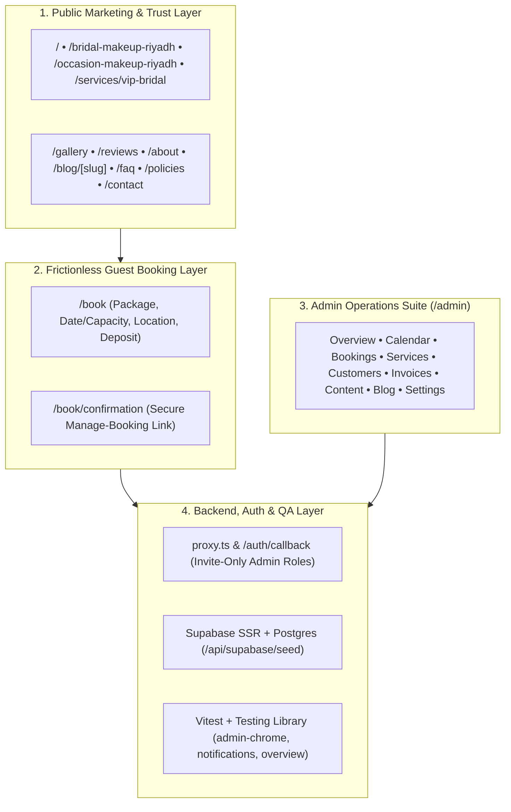

# Amani Khalil (`Amani-KhalIi`) — Luxury Bridal & Occasion Makeup Booking Platform (Riyadh)

A bilingual (Arabic-first, English second) Next.js 16 and Supabase booking, trust-building, and business operations platform for a certified makeup artist delivering private in-home sessions across **Riyadh, Saudi Arabia**.

---

## 1. Executive Summary & Purpose
`Amani-KhalIi` is engineered around a single business metric: **converting mobile visitors into confirmed, deposit-backed bookings in under two minutes without requiring account registration**. It pairs high-trust SEO landing pages (`/bridal-makeup-riyadh`, `/occasion-makeup-riyadh`, `/services/vip-bridal`) with an artist-aware scheduling engine (`Asia/Riyadh`, SAR currency, configurable session capacity) and a full-featured `/admin` suite.

---

## 2. System Architecture & Layers



| Layer | Responsibility | Key Files |
| :--- | :--- | :--- |
| **Marketing & Local SEO Layer** | Arabic-first trust pages, animated studio banner, scroll reveals, and service showcases | `app/(marketing)/*`, `app/{bridal-makeup-riyadh,occasion-makeup-riyadh,services/vip-bridal,gallery,reviews,blog,faq,policies,contact}/page.tsx` |
| **Guest Booking Layer** | Accountless mobile booking flow with phone verification and confirmation tracking | `app/book/_components/booking-flow-client.tsx`, `app/book/confirmation/_components/confirmation-client.tsx` |
| **Admin Operations Layer** | Role-gated business management: calendar availability, bookings, CRM, invoicing, dynamic pricing, CMS | `app/admin/{bookings,calendar,content,customers,invoices,services,settings,blog}/page.tsx`, `components/admin-chrome.tsx` |
| **Data & Business Rules Layer** | Dynamic pricing, add-ons, travel fees, and artist-capacity scheduling (`CLIENT_HOME` / `STUDIO`, UTC storage -> `Asia/Riyadh`) | `lib/`, `features/`, `supabase/`, `app/api/supabase/seed/route.ts`, `PROJECT_SPEC.md` |
| **QA & Component Layer** | Accessible Radix UI primitives, `sonner` toasts, and Vitest component tests | `components/ui/*`, `components/__tests__/*`, `app/admin/_components/__tests__/admin-overview.test.tsx` |

---

## 3. Core Functionality & Modules
- **Dedicated Riyadh SEO Funnels**: Targeted pages for Bridal Makeup (`/bridal-makeup-riyadh`), Occasion Makeup (`/occasion-makeup-riyadh`), and VIP Bridal (`/services/vip-bridal`).
- **2-Minute Guest Booking Flow (`/book`)**: Clients choose a package, select an available date/time slot (respecting ~2-hour sessions and artist daily travel capacity), provide Riyadh home location details, and receive a confirmation link (`/book/confirmation`).
- **Consent-Based Social Proof**: Verified client reviews tied to completed bookings (`/reviews`), curated portfolio (`/gallery`), and educational blog (`/blog/[slug]`).
- **Dynamic Business Configuration**: Zero hardcoded prices—all package rates, add-ons, travel fees, and deposit percentages are DB-driven and editable from `/admin/services` and `/admin/settings`.
- **Full Admin Suite (`/admin`)**:
  - **Bookings & Calendar**: Manage upcoming sessions and block unavailable dates.
  - **Customers & Invoices**: Client history CRM and SAR invoice tracking.
  - **Services & Content**: Create/edit packages (`/admin/services/new`), page copy (`/admin/content`), and blog posts (`/admin/blog`).

---

## 4. Project Structure
```text
├── app/
│   ├── (marketing)/          # Home landing experience
│   ├── admin/                # Invite-only admin dashboard (bookings, calendar, customers, invoices, services, blog, content, settings)
│   ├── api/supabase/seed/    # Database seeding endpoint
│   ├── auth/callback/        # Supabase auth callback
│   ├── blog/                 # Blog listing & [slug] posts
│   ├── book/                 # Guest booking & confirmation
│   ├── bridal-makeup-riyadh/ # Bridal SEO landing page
│   ├── occasion-makeup-riyadh/# Occasion SEO landing page
│   ├── services/             # Services catalog & vip-bridal
│   ├── gallery/, reviews/, about/, faq/, policies/, contact/
├── components/               # UI primitives, admin-chrome, scroll-reveal, tests
├── features/                 # Domain feature modules
├── lib/ & providers/         # Supabase clients, helpers & context providers
├── supabase/                 # Database schema & migrations
└── PROJECT_SPEC.md           # Full business rules & architecture spec
```

---

## 5. Getting Started

```bash
git clone https://github.com/islamsamyy/Amani-KhalIi.git
cd Amani-KhalIi
npm install
```

| Script | Description |
| :--- | :--- |
| `npm run dev` | Start Next.js 16 dev server |
| `npm run build` | Build production bundle |
| `npm run start` | Start production server |
| `npm run lint` | Run ESLint |
| `npm test` | Run Vitest unit & component tests |

---

## 6. Business Value & Growth Opportunities
- **Higher Booking Conversion & Zero-Commission Revenue**: Replaces Instagram/WhatsApp DM back-and-forth and third-party marketplace fees with direct, deposit-secured bookings.
- **Multi-Artist Studio Expansion**: The architecture is already artist-aware (`CLIENT_HOME` vs. `STUDIO` and per-artist daily capacity), allowing Amani to onboard associate makeup artists and take a platform/agency commission per booking.
- **Saudi Payment Gateways (Moyasar / Tabby / Tamara)**: Integrating local SAR payment & BNPL providers on `/book` will maximize high-ticket VIP Bridal conversions.
- **Automated WhatsApp Reminders**: Send automated pre-session preparation checklists, location pins, and post-session review links to drive organic 5-star testimonials.
