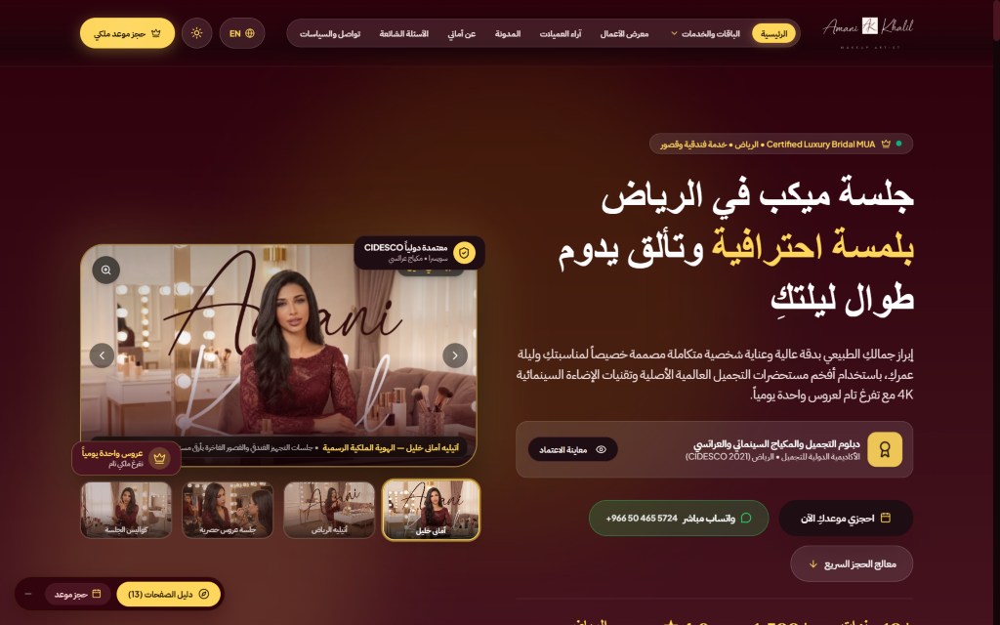
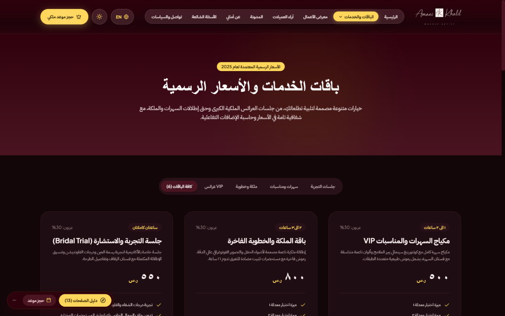
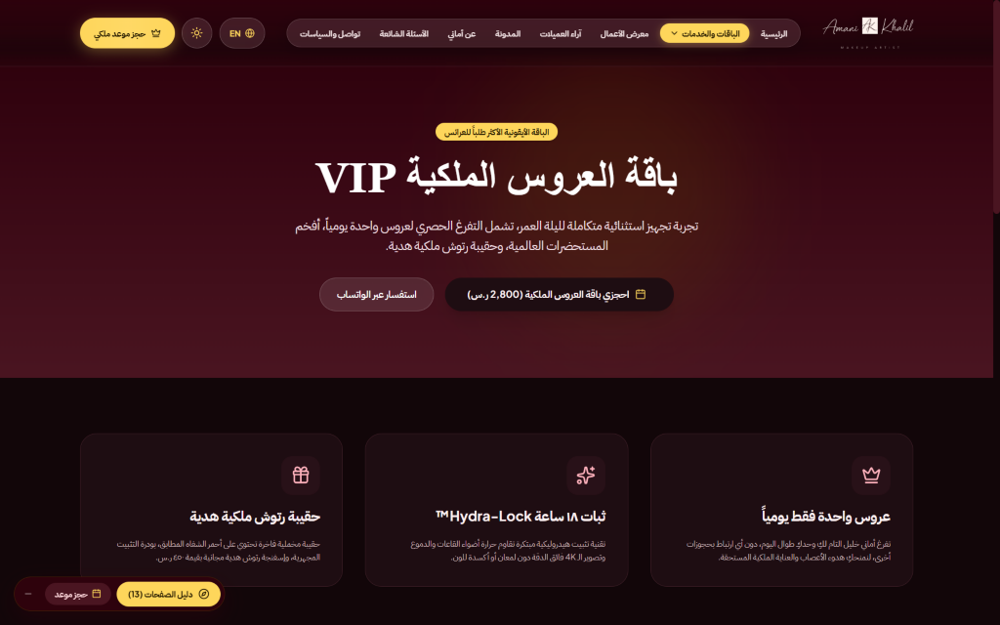
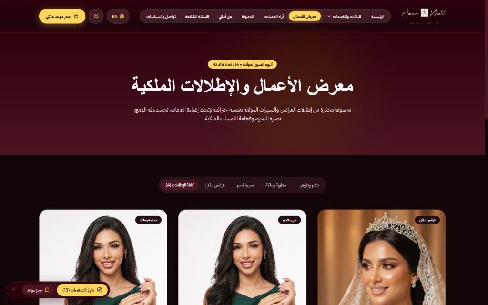
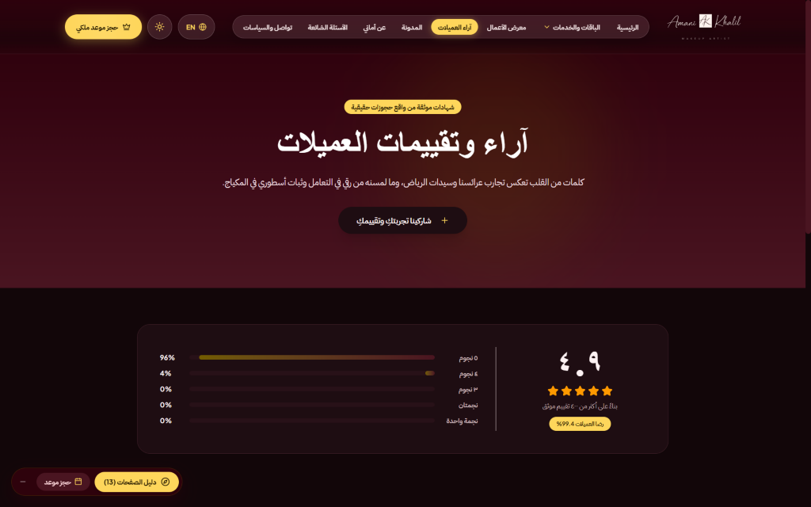
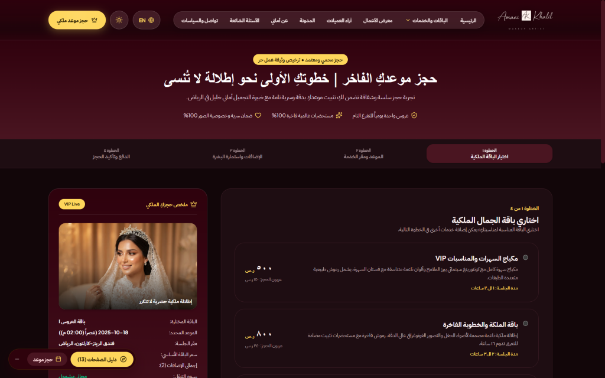
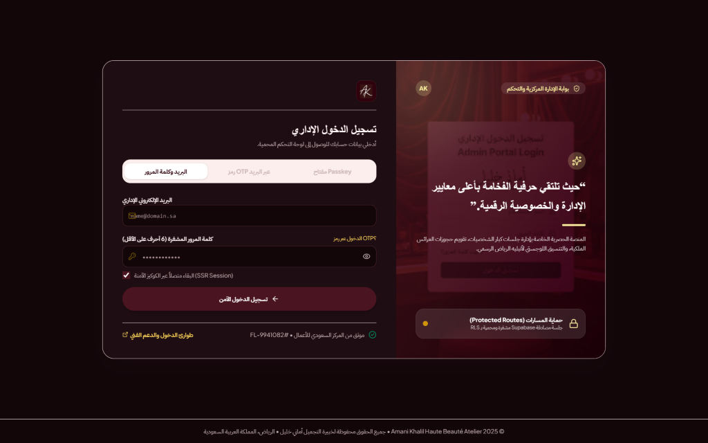

# بربوزال تجاري وفني متكامل — منصة أماني خليل للحجوزات وإدارة الأتيليه (`Amani-KhalIi`)

**مقدم إلى:** إدارة أتيليه خبيرة التجميل أماني خليل / شركاء النمو في قطاع التجميل الفاخر (الرياض، المملكة العربية السعودية)  
**التصنيف:** نظام حجوزات رقمي فاخر + بوابة إدارة عمليات متكاملة (B2C Luxury Booking & Studio ERP)  
**النطاق الجغرافي والعملة:** مدينة الرياض (`Asia/Riyadh`) — الريال السعودي (`SAR`)

---

## 1. الملخص التنفيذي (Executive Summary)

تُعد منصة **أماني خليل (`Amani-KhalIi`)** نظاماً رقمياً متكاملاً مصمماً خصيصاً لعلامات التجميل الفاخرة وخدمات العرائس والمناسبات الخاصة في **الرياض**. يجمع النظام بين **واجهة تسويقية فاخرة ثنائية اللغة** (العربية أولاً، مع دعم الإنجليزية)، و**محرك حجز فوري بدون تسجيل حساب** يحوّل الزائرة إلى حجز مؤكد بعربون في أقل من دقيقتين من الجوال، و**لوحة تحكم إدارية مركزية (`/admin`)** لإدارة المواعيد، الفواتير، العميلات، الأسعار الديناميكية، والمحتوى.

---

## 2. التحديات التشغيلية التي يعالجها النظام

| التحدي التقليدي في قطاع التجميل | الحل الذي يقدمه نظام `Amani-KhalIi` |
| :--- | :--- |
| **استنزاف الوقت في رسائل الواتساب والإنستغرام** للرد على الأسعار والمواعيد المتاحة. | **عرض شفاف للباقات وحاسبة أسعار تفاعلية** مع حجز مباشر في 4 خطوات واضحة. |
| **ضياع الحجوزات أو تضارب المواعيد** عند إدارة الجدول يدوياً. | **تقويم ذكي مرتبط بسعة الخبيرة** (تفرغ لعروس واحدة أو جلستين يومياً مع حظر التواريخ المغلقة). |
| **عدم وضوح رسوم الانتقال بين أحياء الرياض** إلا بعد التفاوض. | **مصفوفة أحياء الرياض الديناميكية** التي تحسب رسوم التنقل تلقائياً في ملخص الحجز. |
| **تشتت بيانات العميلات والفواتير** بين المحادثات والملفات. | **سجل عميلات موحد (CRM) وفواتير مؤتمتة** لكل حجز وعربون داخل لوحة الإدارة. |
| **صعوبة بناء الثقة الفورية مع العرائس الجدد.** | **عرض الاعتماد الدولي (CIDESCO)**، معرض الأعمال، وآراء العميلات الموثقة في الواجهة الرئيسية. |

---

## 3. جولة بصرية في النظام الفعلي (System Screenshots)

### أ. الواجهة التسويقية وبناء الثقة الفورية
1. **الصفحة الرئيسية (`/`)** — إبراز الهوية الملكية، الاعتماد الدولي CIDESCO، أزرار الحجز السريع، ومعرض الإطلالات:
   

2. **صفحة الباقات والخدمات (`/services`)** — تصفية حسب الفئة، بطاقات الباقات، وحاسبة الإضافات التفاعلية:
   

3. **صفحة باقة العروس الملكية (`/services/vip-bridal`)** — صفحة هبوط مخصصة للباقة الأعلى قيمة (High-Ticket Conversion):
   

4. **معرض الأعمال (`/gallery`) وآراء العميلات (`/reviews`)** — تعزيز المصداقية الاجتماعية:
   | معرض الأعمال | آراء العميلات |
   | :---: | :---: |
   |  |  |

### ب. رحلة الحجز الفوري وبوابة الإدارة
5. **معالج الحجز الذكي (`/book`)** — 4 خطوات بدون إنشاء حساب، مع ملخص مالي حي (الباقة + الإضافات + رسوم الحي + العربون):
   

6. **بوابة الدخول الإدارية (`/admin/login`)** — بوابة محمية بصلاحيات الدعوة فقط (Invite-Only RBAC) لإدارة الحجوزات والتقويم والفواتير والمحتوى:
   

---

## 4. الفوائد التجارية والعائد على الاستثمار (Business Benefits & ROI)

### 1. تعظيم الإيرادات وحماية هوامش الربح (100% Direct Revenue)
* **صفر عمولات للوسطاء:** استقبال الحجوزات مباشرة عبر الموقع يوفّر عمولات التطبيقات والمنصات الخارجية (التي تتراوح عادةً بين 15% و25%).
* **رفع متوسط قيمة الطلب (AOV):** تتيح خطوة "الإضافات واستمارة البشرة" بيع خدمات إضافية (مثل جلسة التجربة، المرافقات، الرموش الفاخرة) بسلاسة أثناء الحجز.

### 2. رفع معدل التحويل من الجوال (Mobile-First Conversion)
* تجربة حجز **بدون تسجيل دخول أو كلمة مرور** (Accountless Guest Booking) برقم الجوال فقط، مما يقلل نسبة ترك السلة/الحجز ويزيد الحجوزات المؤكدة بالعربون.

### 3. كفاءة تشغيلية عالية وتفرغ كامل للإبداع
* أتمتة حساب العربون، تأكيد الموعد عبر رابط إدارة خاص، وإصدار الفواتير داخل `/admin/invoices` تقلل العبء الإداري اليومي بنسبة كبيرة.
* **التحكم الكامل بالأسعار من لوحة الإدارة:** لا توجد أي أسعار ثابتة في الكود؛ يمكن تعديل أسعار الباقات، نسبة العربون، ورسوم أحياء الرياض في أي وقت.

### 4. تحسين الظهور في محركات البحث بالرياض (Local SEO Advantage)
* صفحات هبوط مخصصة ومهيأة لمحركات البحث مثل `/bridal-makeup-riyadh` و`/occasion-makeup-riyadh` ومدونة `/blog/[slug]` لجذب عميلات يبحثن مباشرة عن "ميكب عرائس الرياض" بتكلفة استحواذ أقل على المدى الطويل.

### 5. الأمان، الخصوصية، وسلامة البيانات
* **حساب التسعير من جهة الخادم (Server-Side RPC):** يمنع أي تلاعب بالأسعار أو الخصومات من متصفح المستخدم.
* **سياسات خصوصية الصور:** النشر في المعرض والتقييمات يخضع لموافقة العميلة الصريحة فقط.
* **بنية Supabase + RLS:** عزل تام لبيانات العميلات والحجوزات بصلاحيات وصول مشددة.

---

## 5. خارطة التوسع والنمو المستقبلي (Growth Opportunities)

تم بناء البنية التقنية للنظام لتدعم التوسع التجاري دون إعادة بناء:
1. **التحول إلى وكالة تجميل متعددة الخبيرات (Multi-Artist Agency):** النظام مصمم مسبقاً ليكون واعياً بهوية الخبيرة (`artist-aware`) ونوع الموقع (`CLIENT_HOME` و`STUDIO`)، مما يتيح إضافة خبيرات مساعدات وأخذ عمولة على كل حجز.
2. **تفعيل الدفع السعودي الفوري والتقسيط (Mada / Apple Pay / Tabby / Tamara):** ربط بوابات الدفع المحلية في الخطوة الرابعة من `/book` لرفع مبيعات باقة العروس الملكية VIP.
3. **أتمتة رسائل الواتساب (WhatsApp Business Lifecycle):** إرسال رسالة ترحيب وتجهيز البشرة قبل الموعد، ورابط التقييم التلقائي بعد انتهاء الجلسة.
4. **بطاقات الإهداء وبرامج الولاء:** إتاحة باقات إهداء للعرائس والمناسبات مع تتبع الرصيد في سجل العميلات.

---

## 6. ملخص الجاهزية الفنية (Technical Readiness)

* **الأداء والسرعة:** مبني على أحدث إصدارات **Next.js 16 (App Router)** و**React 19** و**Tailwind CSS 4**.
* **الاختبارات والجودة:** مزود بحزمة اختبارات آلية (**Vitest**) تغطي واجهات الحجز ولوحة الإدارة وإدارة المحتوى (10 ملفات اختبار، 33 اختباراً ناجحاً).
* **جاهزية النشر:** جاهز للاستضافة السحابية الفورية على **Vercel + Supabase** مع تحديث تلقائي للجلسات (`SSR Cookies`).

---

> **للتواصل والاستفسار التجاري أو طلب عرض حي للنظام:**  
> مستودع المشروع الرسمي: `https://github.com/islamsamyy/Amani-KhalIi`

