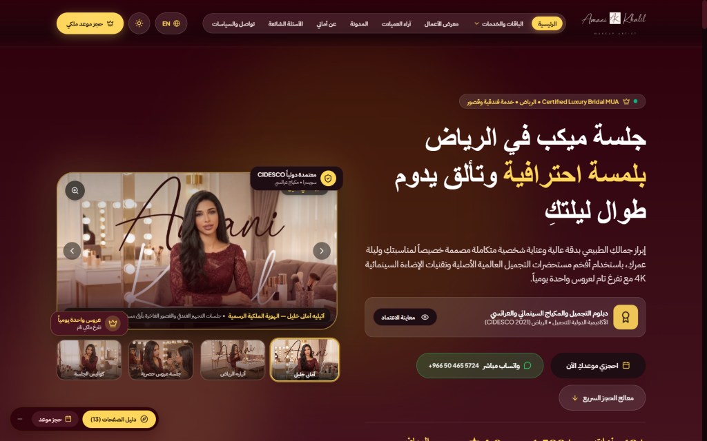
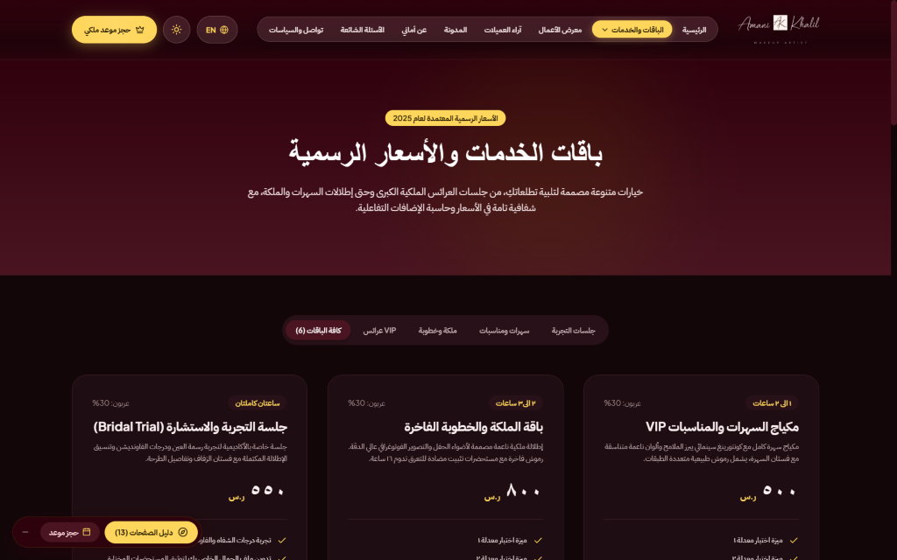
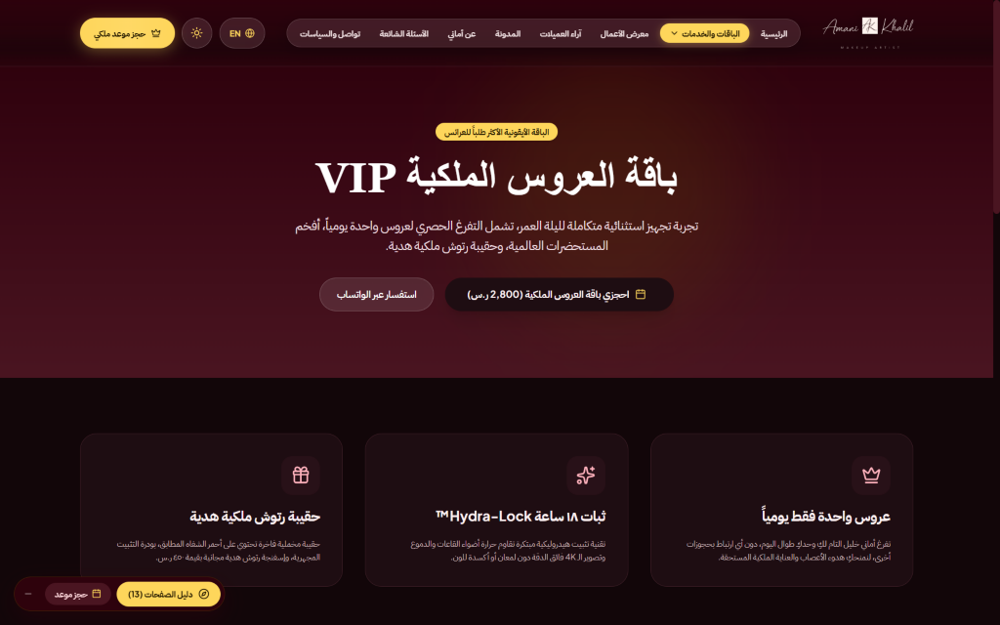
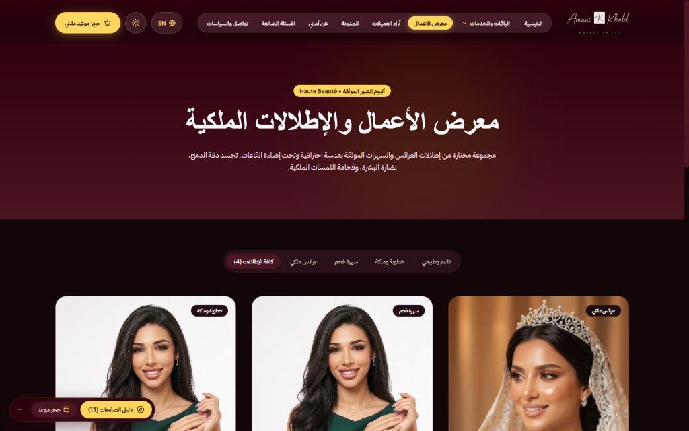
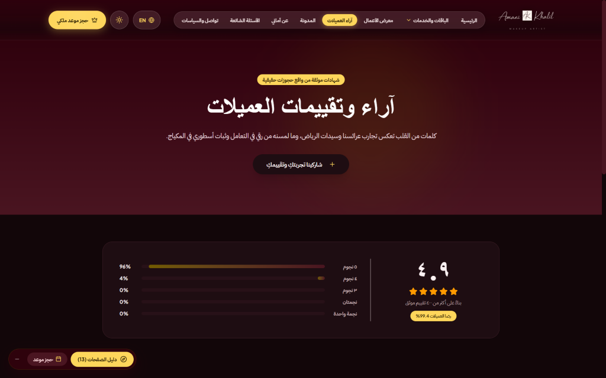
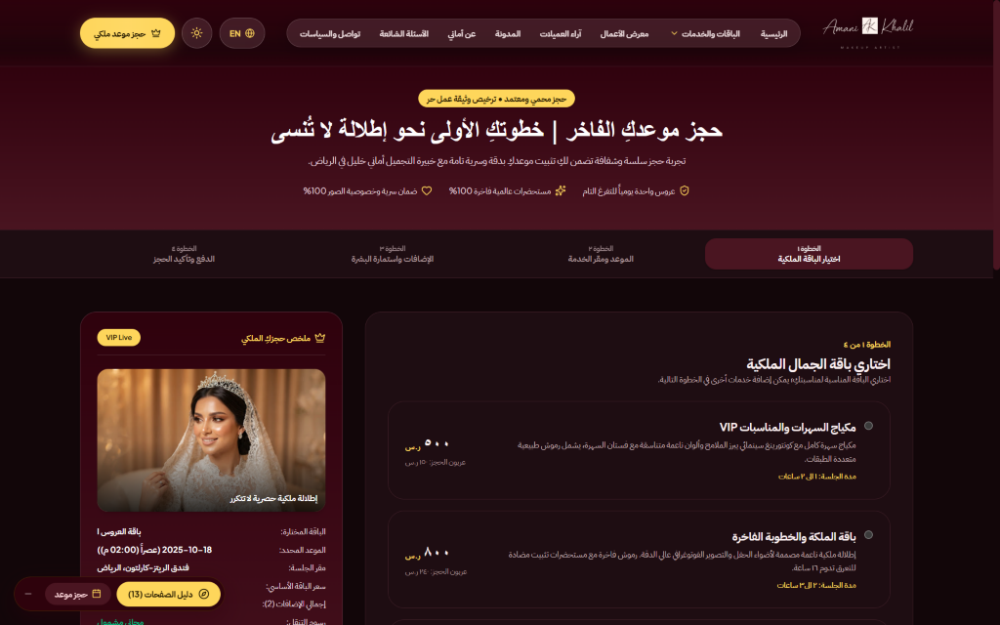
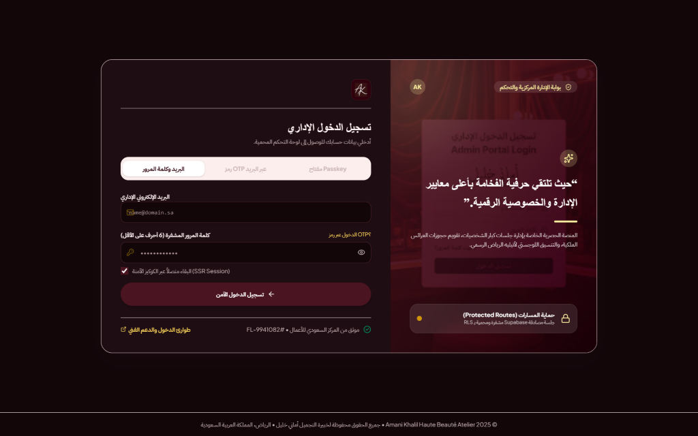

# Amani Khalil (`Amani-KhalIi`) — Detailed Project Documentation

> **Platform:** Bilingual (Arabic-first RTL / English LTR) Luxury Bridal & Occasion Makeup Booking & Studio Operations Platform  
> **Target Market:** Riyadh, Saudi Arabia (`Asia/Riyadh`, `SAR`)  
> **Stack:** Next.js 16.4.6 (App Router, Turbopack), React 19.3, TypeScript 5, Tailwind CSS 4, Radix UI, Supabase (`@supabase/ssr`, `@supabase/supabase-js`), Vitest 4

---

## 1. System Overview & Core Objectives

`Amani-KhalIi` is a full-stack web application built for **Amani Khalil**, a CIDESCO-certified bridal and occasion makeup artist operating across Riyadh. The platform replaces manual DM/WhatsApp scheduling with an end-to-end digital concierge experience:

1. **Instant Trust & Conversion (Public Marketing & Local SEO):** Showcases international certification, real client reviews, curated portfolio looks, and Riyadh-targeted SEO landing pages (`/bridal-makeup-riyadh`, `/occasion-makeup-riyadh`, `/services/vip-bridal`).
2. **Frictionless Accountless Booking (`/book`):** Converts mobile and desktop visitors into deposit-secured appointments in under two minutes using only their phone number and booking details—no account registration required.
3. **Centralized Studio Operations (`/admin`):** Invite-only, role-gated dashboard for managing bookings, artist availability/calendar, Riyadh district travel fees, dynamic service packages, customer CRM, invoices, blog/CMS content, and studio settings.

---

## 2. Technology Stack

| Layer | Technology / Package | Purpose |
| :--- | :--- | :--- |
| **Framework** | `next` (`16.4.6`, App Router) | Server/Client rendering, route handlers, SEO metadata |
| **UI & Styling** | `react` (`19.3.0`), `tailwindcss` (`^4`), `@radix-ui/*`, `lucide-react`, `sonner` | Luxury burgundy & gold theme, dark/light mode, accessible dialogs/tabs/selects, toast notifications |
| **Backend & Auth** | `@supabase/supabase-js` (`2.118.0`), `@supabase/ssr` (`0.12.7`) | Postgres database, Row-Level Security (RLS), server RPCs, SSR cookie sessions |
| **Domain Logic** | `features/booking/pricing.ts`, `features/data/initial-data.ts` | Server/client shared pricing calculation, initial catalog/Riyadh areas |
| **Testing** | `vitest` (`4.1.12`), `@testing-library/react`, `happy-dom`, `jsdom` | Unit and component integration tests |
| **Linting** | `eslint` (`^9`), `eslint-config-next` | Code quality and Next.js best practices |

---

## 3. Application Architecture & Directory Structure

```text
my-app/
├── app/
│   ├── page.tsx                         # Home page (Arabic-first hero, signature styles, trust signals)
│   ├── about/page.tsx                   # Artist biography, CIDESCO credentials, studio philosophy
│   ├── services/
│   │   ├── page.tsx                     # Interactive packages, category filter, price calculator & comparison
│   │   └── vip-bridal/page.tsx          # Dedicated VIP Bridal luxury experience page
│   ├── bridal-makeup-riyadh/page.tsx    # Local SEO landing page for Riyadh bridal makeup
│   ├── occasion-makeup-riyadh/page.tsx  # Local SEO landing page for Riyadh evening/occasion makeup
│   ├── gallery/page.tsx                 # Filterable portfolio showcase
│   ├── reviews/page.tsx                 # Verified client testimonials & rating breakdown
│   ├── blog/
│   │   ├── page.tsx                     # Beauty & bridal preparation articles
│   │   └── [slug]/page.tsx              # Dynamic article detail page
│   ├── faq/page.tsx                     # Frequently asked questions
│   ├── policies/page.tsx                # Deposit, cancellation, privacy & photo consent policies
│   ├── contact/page.tsx                 # Direct inquiry & Riyadh service coverage
│   ├── book/
│   │   ├── page.tsx                     # 4-step guest booking wizard
│   │   └── confirmation/page.tsx        # Booking confirmation & manage-booking summary
│   ├── admin/
│   │   ├── login/page.tsx               # Invite-only admin login (Password / OTP / Passkey UI)
│   │   ├── page.tsx                     # Admin overview KPIs & recent activity
│   │   ├── bookings/page.tsx            # Booking triage, status updates & filtering
│   │   ├── calendar/page.tsx            # Artist-aware schedule & blocked dates
│   │   ├── customers/page.tsx           # Client CRM & repeat-booking history
│   │   ├── invoices/page.tsx            # Invoice & deposit tracking
│   │   ├── services/page.tsx            # Dynamic package & add-on pricing manager
│   │   ├── services/new/page.tsx        # Create new service package
│   │   ├── content/page.tsx             # Gallery & review moderation CMS
│   │   ├── blog/page.tsx                # Blog post editor & publisher
│   │   └── settings/page.tsx            # Studio policies, Riyadh travel fees & system settings
│   ├── api/supabase/seed/route.ts       # Database seed initializer endpoint
│   └── auth/callback/route.ts           # Supabase auth callback handler
├── components/                          # Shared UI, Radix primitives, theme/language toggles, admin chrome
├── features/
│   ├── booking/pricing.ts               # Dynamic package + add-on + Riyadh travel fee + deposit calculation
│   └── data/initial-data.ts             # Default packages, add-ons, Riyadh districts, reviews, FAQs
├── lib/
│   ├── supabase/{client,server,middleware,config}.ts
│   ├── image-upload.ts                  # Client/admin image upload helpers
│   └── utils.ts                         # Formatting & class-name utilities
├── providers/                           # Global app store, theme, and localization providers
├── supabase/
│   ├── schema.sql                       # Base schema definition
│   └── migrations/
│       ├── 002_relations_security_rpc.sql
│       ├── 003_server_pricing_confirmation.sql
│       ├── 004_fix_sync_and_admin_mutations.sql
│       └── 005_admin_delete_operations.sql
├── proxy.ts                             # Next.js request proxy refreshing Supabase SSR sessions
└── test/                                # Vitest setup and unit/integration tests
```

---

## 4. Visual System Walkthrough

### Public Experience & Local SEO
| Home Page (`/`) | Services & Calculator (`/services`) | VIP Bridal (`/services/vip-bridal`) |
| :---: | :---: | :---: |
|  |  |  |

| Portfolio Gallery (`/gallery`) | Client Reviews (`/reviews`) |
| :---: | :---: |
|  |  |

### Guest Booking & Admin Operations
| 4-Step Guest Booking (`/book`) | Admin Portal Login (`/admin/login`) |
| :---: | :---: |
|  |  |

---

## 5. Business Rules, Data Model & Security

### Core Domain Rules
- **Timezone & Currency:** All timestamps are persisted in UTC and rendered in `Asia/Riyadh` (UTC+3). All prices are denominated in Saudi Riyals (`SAR`).
- **Dynamic Pricing (Zero Hardcoded Prices):** Service packages (`service_packages`), optional add-ons (`addons`), Riyadh neighborhood travel fees (`riyadh_areas`), and deposit percentages are stored in Postgres and editable from `/admin/services` and `/admin/settings`.
- **Artist-Aware Capacity:** Sessions default to ~2 hours with ~2 sessions/day per artist, supporting both `CLIENT_HOME` (active) and `STUDIO` (ready for expansion) location types.
- **Privacy & Consent:** Client reviews are published only with explicit client consent; photo privacy is guaranteed by policy.

### Database Tables & Migrations
Defined in `supabase/schema.sql` and migrations `002` through `005`:
- `public.admin_users`: Invite-only admin accounts & RBAC roles
- `public.service_packages`: Bridal, VIP, Queen/Engagement, and Trial packages
- `public.addons`: Optional add-ons (hair styling, trial session, extra guests, etc.)
- `public.riyadh_areas`: Riyadh districts with zone-based travel fee matrix
- `public.customers`: Guest & repeat client CRM profiles
- `public.bookings`: Appointments, artist assignment, location type, deposit & status
- `public.invoices`: Deposit and balance invoice records
- `public.blocked_dates`: Calendar blackout dates and capacity overrides
- `public.reviews`, `public.gallery_looks`, `public.blog_posts`, `public.faqs`: Social proof & CMS tables

### Security & Server-Side Integrity
- **Server-Side Pricing & Confirmation (`003_server_pricing_confirmation.sql`):** Prevents client-side price tampering by calculating totals, travel fees, and deposits inside Postgres RPCs.
- **SSR Session Refresh (`proxy.ts` + `lib/supabase/middleware.ts`):** Keeps Supabase auth cookies synchronized on every request.
- **Row-Level Security (RLS) & Admin Mutations (`002`, `004`, `005`):** Restricts administrative reads, updates, and deletes to authenticated `admin_users`.

---

## 6. Verification & Testing

The project includes an automated **Vitest** suite covering smoke checks, store/auth sync, theme and language toggles, admin chrome, notifications, calendar, overview KPIs, home enhancements, and gallery CMS operations:

```bash
npm run lint     # ESLint 9
npm test         # Vitest (10 test files, 33 tests passing)
npm run build    # Production Next.js build
```

---

## 7. Business Value & Strategic Growth Roadmap

1. **Zero Commission Leakage:** Direct bookings eliminate third-party marketplace fees while preserving 100% of high-ticket bridal margins.
2. **Under-2-Minute Mobile Conversion:** Accountless booking with live SAR pricing breakdown removes WhatsApp back-and-forth.
3. **Multi-Artist Agency Readiness:** Artist-aware scheduling (`CLIENT_HOME` / `STUDIO`) allows onboarding junior artists under the Amani Khalil brand.
4. **Local Payment & BNPL Integration:** Ready to connect Moyasar / HyperPay (Mada, Apple Pay) and Tabby / Tamara installments on `/book`.
5. **Automated WhatsApp Lifecycle:** Can trigger pre-session prep checklists and post-session consent review links automatically.
